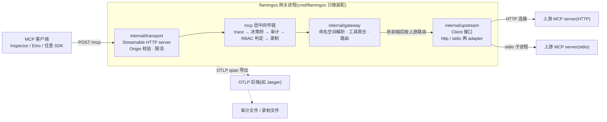
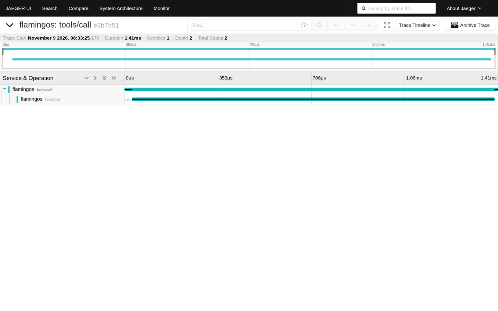

# flamingos

flamingos 是一个 MCP(Model Context Protocol)网关,Go 实现:把多个上游 MCP server 的工具聚合到单一 Streamable HTTP 端点,并在网关层提供全链路追踪、访问策略与审计、结果缓存与行为基准(录制 / 回放 / 确定性断言)。Agent 侧(Inspector、Eino、任意 MCP SDK)只看到一个端点;上游侧 HTTP 与 stdio 两类 server 都可挂。

- 语言与运行形态:Go(go.mod 声明 go 1.27.1),对外为 Stateless Streamable HTTP(每请求独立,服务端无会话状态)。
- 聚合命名:工具全名 = `上游命名空间_ + 原始工具名`(命名空间禁下划线,路由按第一个 `_` 拆分,零歧义)。
- 配置驱动:全部能力按 YAML 配置段开关,段缺省即关闭、零挂点、零行为变化。

## 架构

依赖单向:`cmd → transport → gateway → upstream`,编译器守门;全部模块清单、接口契约与决策记录见 [docs/design/architecture.md](docs/design/architecture.md)。



装配层事实(读图注意):结果缓存(internal/cache)是 cmd 装配层的 `upstream.Client` 装饰器,挂在命名空间解析与路由之后、传输之前;录制(internal/recorder)是 mcp 层 Receiving 链末位,deny 不入录制;两者与策略段一样,配置段缺省 = 关闭零挂点。

## Quick start

前置:Go ≥ 1.27(与 go.mod 声明一致);可选 Docker(可观测环境)。

1. 起一个上游 MCP server。用仓库内的假上游夹具(echo 工具回显原始参数字节,与 e2e / 压测同款):

   ```sh
   go build -o /tmp/httpserver ./internal/upstream/testdata/httpserver
   /tmp/httpserver 127.0.0.1:9001
   ```

2. 写最小配置 `flamingos.yaml`(单 http 上游即可,其余全部缺省关闭):

   ```yaml
   listen: 127.0.0.1:8080
   upstreams:
     - name: calc
       type: http
       url: http://127.0.0.1:9001/mcp
       timeout: 5s
   ```

3. 启动网关(仓库根):

   ```sh
   go run github.com/magician336/flamingos/cmd/flamingos -config flamingos.yaml
   ```

4. 最小验证。网关是 Stateless Streamable HTTP,裸 POST 即可(无需 initialize 握手):

   ```sh
   curl -s -X POST http://127.0.0.1:8080/mcp \
     -H 'Content-Type: application/json' \
     -H 'Accept: application/json, text/event-stream' \
     -d '{"jsonrpc":"2.0","id":1,"method":"tools/call","params":{"name":"calc_echo","arguments":{"text":"hello"}}}'
   ```

   应答为 `200 text/event-stream` 单 data 帧,`data:` 行内 JSON-RPC 应答的 `content[0].text` 即回显原文。

5. MCP Inspector 连接:`npx @modelcontextprotocol/inspector`,传输形态选 Streamable HTTP,URL 填 `http://127.0.0.1:8080/mcp`。Inspector 对无状态端点的握手形态以 Inspector 与 go-sdk 文档为准;若所用版本行为有差异,以上面第 4 步的 curl 裸调用作为最小验证兜底。

6. 可观测(可选):`cd observability && docker compose up -d` 拉起 Jaeger,配置加 `telemetry:` 段(指向 `localhost:4317`),详见 [observability/README.md](observability/README.md)。一次 tools/call 的全链路 trace 树(server span + 上游 client span)形态如下:

   

## 能力总览

| 能力 | 一行说明 | 配置入口 | 详情与证据 |
|---|---|---|---|
| 工具聚合与转发 | 多上游 `tools/list` 聚合(命名空间前缀)与 `tools/call` 路由;HTTP 与 stdio 两类上游 | `upstreams` | [docs/design/architecture.md](docs/design/architecture.md)、[docs/specs/0002-http-upstream-aggregation-forwarding.md](docs/specs/0002-http-upstream-aggregation-forwarding.md)、[docs/specs/0003-stdio-upstream-adapter.md](docs/specs/0003-stdio-upstream-adapter.md) |
| 全链路追踪 | OTel span 树:一次 tools/call 对应 server span + 上游 client span(属性带上游名 / 类型 / 聚合工具名);traceparent 头注入,stdio 上游走 `_meta` 通道(SEP-414);段缺省关闭零开销 | `telemetry` | [docs/specs/0004-otel-tracing-meta-propagation.md](docs/specs/0004-otel-tracing-meta-propagation.md)、[observability/README.md](observability/README.md) |
| 策略:RBAC / 审计 / 限流 / Origin | 角色通配规则放行与拒绝、工具级 JSON-lines 审计(deny 也落盘)、全局令牌桶限流、Origin 允许列表;四个子段各自开关 | `policy` | [docs/specs/0005-policy-rbac-audit-ratelimit.md](docs/specs/0005-policy-rbac-audit-ratelimit.md) |
| 结果缓存 | 聚合工具结果缓存:通配规则 + `ttl_ms`,public 全局共享 / private 缓存键含角色;命中态收益见下节压测数字 | `cache` | [docs/specs/0006-cache-tool-results.md](docs/specs/0006-cache-tool-results.md)、[docs/benchmark.md](docs/benchmark.md) |
| 行为基准 evalx | 实际执行的 tools/call 录制为 JSON-lines,回放 + 五种确定性断言 + 三态退出码门禁 | `recorder` | [docs/specs/0008-evalx-record-replay-grader.md](docs/specs/0008-evalx-record-replay-grader.md)、本文 evalx 节 |

## 压测与故障演练

数字与边界的唯一出处是两份报告,此处只做关键数字对照,不复述整表;方法学、环境交代与复现命令均在文档内。

压测([docs/benchmark.md](docs/benchmark.md),vegeta 库形态,三进程同机回环,零错误):

- 关闭态全链路相对开销(经网关 − 直连基线):50 / 200 / 500 rps 三档 P50 差 +1.509 / +1.195 / +0.968 ms,P99 差 ≤ 2.1 ms——聚合的延迟成本为毫秒量级。
- 阶梯加载:50→800 rps 实际吞吐紧贴排程速率,测试范围内未观察到容量拐点。
- 缓存命中态 vs 关闭态(200 rps,public 规则 ttl=5s):P50 1.878 ms → 0.684 ms(−64%),命中态分位与直连基线几乎重合。

故障演练([docs/drills.md](docs/drills.md),kill -9 / 断流重发 / 异常注入三族,七场景):

- HTTP 上游骤死:恢复窗口毫秒级(36.3 / 35.8 / 43.9 ms),网关会话不重连即恢复,上游可独立于网关重启。
- stdio 上游骤死:无再拉起机制,恢复路径 = 重启网关进程,窗口百毫秒级(376.1 / 64.9 ms)。
- 协议外应答注入:不击穿网关进程,但废掉网关到该上游的单条会话,恢复 = 网关重启。
- 七个场景网关进程全部存活,未发现任何进程级崩溃路径。

两份报告的数字边界(同机回环、内存桩上游、单次运行观测)见各自 Limitations 节;复现命令:压测全量经环境变量门控 `FLAMINGOS_BENCHMARK=1 go test ./benchmark -run '^TestBenchmarkFullScenarios$' -v`,演练随 `go test ./e2e` 常规执行。

## evalx:行为基准(录制、回放与确定性断言)

录制:配置顶层 `recorder:` 段声明落盘路径,段缺省 = 关闭零挂点;只录实际执行的 `tools/call`(方法、聚合工具名、参数原始字节、成功 / 业务失败 / 传输错误三态、延迟、trace_id 与角色),deny 不入录制。

```yaml
recorder:
  path: /tmp/flamingos-record.jsonl
```

回放(对运行中的网关端点串行重放录制文件并逐条断言):

```sh
go run ./cmd/evalx -file /tmp/flamingos-record.jsonl \
  -endpoint http://127.0.0.1:8080/mcp \
  -header 'mcp-role: admin' \
  -json
```

CLI 契约(与 [docs/specs/0008-evalx-record-replay-grader.md](docs/specs/0008-evalx-record-replay-grader.md) 的 CLI 契约一致):

- `-file` 录制文件路径(JSON-lines 用例,录制文件即回放用例,期望可显式覆写);
- `-endpoint` 网关端点 URL;
- `-header` 可重复的请求头透传(形态 `名:值`),回放以录制时同口径携带角色等头;
- 报告默认表格,`-json` 为机器形态(条目数、通过数、失败明细含条目号与断言名);
- 退出码三态:`0` 全部通过 / `1` 存在断言失败 / `2` 自身运行错误(文件不可读、端点不可达)。

断言面五种确定性 grader:结果等值(JSON 语义等值,键序无关、数组有序)、错误形态(kind 与错误文案点名)、json-schema 结果形状校验、序列匹配(条目数与聚合名序列)、延迟上限。e2e 套件含 evalx 门禁 family(正例 / 负例 / CLI 契约例),随 `go test ./...` 常规执行——"录制 → 回放 → 断言"作为回归门禁自 spec 0008 起自举。

## 确定性断言与 LLM judge 的适用边界

evalx 内建的是确定性断言面。按 eval 工具的通用二分法(promptfoo 官方口径:断言分 Deterministic 与 Model-assisted 两族),前者是业界基座而非简化妥协:断言结果机器可判、退出码可进脚本门禁,适合"上游与网关变更后行为不回归"的回归场景。工具调用类行为——调没调、调对没调、结果内容与形状、错误形态、延迟阈值——确定性断言可全覆盖,这是 evalx 的定位。

模型辅助评估(LLM-as-judge)适用对象是无唯一正确输出的开放式生成质量评判;代价是判定结果非确定、依赖评审模型与提示词、成本与延迟更高。flamingos 不内建该族:此类评估在调用方(Agent 框架)侧叠加,网关侧以录制文件提供可复现的输入与应答基准,两者不冲突。

## examples:Eino 接入

[examples/](examples/README.md) 是独立 Go module:依赖面(eino、eino-ext officialmcp、go-sdk)隔离在示例侧,主模块 go.mod 零变化。示例经 eino-ext officialmcp 的 `GetTools` 把网关聚合工具桥接为 Eino 工具接口,打印桥接清单并直调其中一个工具;全程无 LLM key 依赖,接入验证不依赖任何厂商账号。

构建方式(examples 目录内,自持 go.mod):

```sh
cd examples
go build ./...
```

运行(端点经 flag 或环境变量注入,直调形态):

```sh
cd examples
go run . -endpoint http://127.0.0.1:8080/mcp \
  -tool calc_echo -args '{"text":"hello from eino"}'
# 或:FLAMINGOS_MCP_ENDPOINT=http://127.0.0.1:8080/mcp go run .
```

`-tool` 缺省取聚合清单首项,`-args` 为参数 JSON 字符串。从直调到 ReAct agent 的接线方式(桥接产物传入 `react.NewAgent` 的 `ToolsConfig`)与官方示例出处(eino-ext officialmcp 的 examples/mcp.go)见 [examples/README.md](examples/README.md)。

## Limitations

砍掉项、简化项与已知边界全清单:

1. **单机内存缓存**:缓存是进程内单一引擎(容量上限 `max_entries`,缺省 1024),无分布式缓存、无持久化;private 规则的缓存键含角色(spec 0006)。
2. **同机压测与演练口径**:压测与演练数字均为三进程同机回环、内存桩上游、单次运行的观测值,只支撑同机相对比较与量级判断,不构成生产容量或生产可用性主张(见 [docs/benchmark.md](docs/benchmark.md) 与 [docs/drills.md](docs/drills.md) 的 Limitations 节)。
3. **stdio 上游简化且无再拉起**:stdio 上游是简化版 adapter,子进程死亡后无再拉起机制,该上游持续不可用,恢复路径 = 重启网关进程;编排方对 stdio 上游故障的看护对象是网关进程而非上游子进程(spec 0003、[docs/drills.md](docs/drills.md))。
4. **协议违规会话边界**:上游返回协议外应答(如非法 Content-Type)会永久关闭网关到该上游的单条客户端会话,该上游后续调用持续报错直至网关重启;传输层骤死(EOF / RST / connection refused)则会话可自愈、下次调用即走新连接。该行为出自 go-sdk v1.8.0 客户端,升级 SDK 需复核(见 [docs/drills.md](docs/drills.md) 场景 7)。
5. **缓存开启态的录制 / 回放误报边界**:录制与回放配置若开缓存,录制文件可能含命中态结果,跨配置回放可能误报;行为基准门禁场景(e2e evalx family)配置缓存关闭(spec 0008 Limitations)。
6. **录制文件含工具结果原文**:录制条目的 `result` 字段是工具应答原文,落盘文件包含上游返回的全部内容;对不可信环境共享录制文件前须自行脱敏,脱敏与加密未内建(spec 0008)。
7. **网关无自动重试、无熔断、无健康探测、无配置热加载**:断流重发是客户端语义;配置变更经重启进程生效(spec 0007)。

## 许可

[Apache-2.0](LICENSE)。
